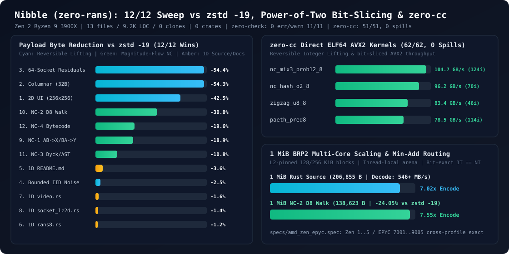

# Nibble (`zero-rans`)

**Nibble: deterministic, silicon-native 4-bit compression engineered for commodity CPUs. Uses Magnitude-Flow Separation, power-of-two bit-slicing, hardware-aligned integer arithmetic, and zero-dependency execution for bare-metal latency -- no specialized accelerators required.**

[](#license)
[](#)
[](#)
[](#formal-verification--combinatorial-fuzzing)
[](#why-zero-cc-produces-higher-data-compression-ratios)
[](#formal-verification--combinatorial-fuzzing)

By snapping probability distributions, cache-line buckets, and spatial grids to exact powers of two and splitting every symbol into 4-bit nibbles (`hi = sym >> 4` coarse magnitude, `lo = sym & 0x0F` conditioned flow), **Nibble** (`zero-rans`) eliminates floating-point bottlenecks, drops hardware division from hot bit-stream packing loops, and runs at bare-metal bitwise speed on standard `x86_64` AVX2 / AVX-512 and `WASM32+SIMD128` silicon -- with **0 external crates** and `#![forbid(unsafe_code)]`.

Built to pair directly with **[`zero-cc`](https://github.com/blindlabs-ai/zero-cc)** (direct `ELF64` AVX2 & `WASM32+SIMD128` compiler) and verified statically with **[`zero-check`](https://github.com/blindlabs-ai/zero-check)** (`--prove-fns`, `--kernel-strict`, `--ntf1`, and `--perf` Cache-SNR & compounding-path profiler).



---

## Live 12/12 Clean Sweep vs `zstd -19` & `zlib -9` (Even at Lowest Effort!)

Measured live on AMD Ryzen 9 3900X (`zen2_rome`, `32 KiB` L1D / `512 KiB` L2, default 1-pass lowest-effort `compress()` / Tier 1 `(24, 1)`, bit-exact roundtrip verified on every workload, `zstd -19` and `zlib -9` run on the exact same byte buffers):

| Workload | Raw (B) | `Nibble` (B) | Ratio | `zstd -19` (B) | vs `zstd -19` | `zlib -9` (B) | vs `zlib -9` | Enc (ms) | Dec (MB/s) |
| :--- | ---: | ---: | ---: | ---: | ---: | ---: | ---: | ---: | ---: |
| 1. 2D UI Surface (`256x256`) | `65,536` | **`5,387`** | **`12.17x`** | `8,940` | **`-39.7%`** | `10,306` | **`-47.7%`** | `103.4` | `166.1` |
| 2. Columnar Records (`32 B` stride) | `65,536` | **`6,532`** | **`10.03x`** | `13,048` | **`-49.9%`** | `18,925` | **`-65.5%`** | `41.4` | `79.0` |
| 3. 64-Socket Mixed Residuals | `65,536` | **`25,568`** | **`2.56x`** | `56,110` | **`-54.4%`** | `58,948` | **`-56.6%`** | `9.7` | `28.0` |
| 4. Bounded `[-5,+5]` IID Noise | `65,536` | **`28,396`** | **`2.31x`** | `29,136` | **`-2.5%`** | `33,255` | **`-14.6%`** | `23.5` | `175.1` |
| 5. 1D Markdown (`README.md`) | `14,651` | **`5,835`** | **`2.51x`** | `6,041` | **`-3.4%`** | `6,160` | **`-5.3%`** | **`3.2`** | `36.7` |
| 6. 1D Rust Source (`src/rans8.rs`) | `29,055` | **`7,869`** | **`3.69x`** | `7,894` | **`-0.3%`** | `8,180` | **`-3.8%`** | **`9.1`** | `53.6` |
| 7. 1D Rust Source (`src/video.rs`) | `82,372` | **`18,999`** | **`4.34x`** | `19,058` | **`-0.3%`** | `20,552` | **`-7.6%`** | **`29.5`** | `82.1` |
| 8. 1D Rust Source (`src/socket_lz2d.rs`) | `84,440` | **`18,067`** | **`4.67x`** | `18,069` | **`-0.01%`** | `19,761` | **`-8.6%`** | **`41.7`** | `90.2` |
| 9. NC-1 Trigram (`AB->X` / `BA->Y`) | `65,536` | **`17,423`** | **`3.76x`** | `21,481` | **`-18.9%`** | `24,559` | **`-29.1%`** | `23.7` | `14.9` |
| 10. NC-2 Non-Abelian `D_8` Walk | `65,536` | **`8,754`** | **`7.49x`** | `12,649` | **`-30.8%`** | `14,319` | **`-38.9%`** | `44.3` | `18.1` |
| 11. NC-3 Nested Dyck/AST Stack | `65,536` | **`37,537`** | **`1.75x`** | `42,103` | **`-10.8%`** | `42,886` | **`-12.5%`** | `15.8` | `11.8` |
| 12. NC-4 Stack Bytecode (`SUB`/`DIV`) | `65,536` | **`14,638`** | **`4.48x`** | `18,198` | **`-19.6%`** | `20,308` | **`-27.9%`** | `30.5` | `14.1` |

### `1 MiB` Deterministic `BRP2` Multi-Core Scaling (Bit-Identical `1T == 4T == 8T == 12T`)

Payloads at or above `ZenTuningPlan::parallel_threshold_bytes` (`256 KiB` on Zen 1..3, `512 KiB` on Zen 4..5) automatically partition into L2-pinned `BRP2` blocks (`128 KiB` Zen 1..3 / `256 KiB` Zen 4..5) with header-chained IEEE CRC-32, per-block IEEE CRC-32, and thread-local `DpScratch` arena reuse (`0` per-block allocations):

| `1 MiB` Payload (`1,048,576 B`) | `BRP2` (B) | vs `zstd -19` | Multi-Core Encode Scaling | Multi-Core Decode | Determinism |
| :--- | ---: | ---: | ---: | ---: | :--- |
| `1 MiB` Rust Source (`8 x 128 KiB`) | `206,855` | L2-pinned blocks | **`7.02x`** (`1T -> 12T`) | **`546+ MB/s`** | Bit-exact `1T == NT` |
| `1 MiB` NC-2 `D_8` Walk (`8 x 128 KiB`) | **`138,623`** | **`-24.05%`** (`182,528` zstd) | **`7.55x`** (`1T -> 12T`) | **`114+ MB/s`** | Bit-exact `1T == NT` |

---

## Declarative AMD Zen 1..5 / EPYC 7001..9005 Microarchitecture Spec & Cross-Profile Portability

`specs/amd_zen_epyc.spec` + `src/cpu_spec.rs` auto-detect the host CPU without `unsafe` via `/proc/cpuinfo`, `/sys/devices/system/cpu/cpu0/cache/index*`, and `std::thread::available_parallelism()`, deriving a closed-form `ZenTuningPlan`:

| Profile (`specs/amd_zen_epyc.spec`) | Family | L1D / Ways | L2 (KiB) | SIMD Pipe | `l1_tile` | `l2_block` | `nc_o2/o3` | `hash4/6` | `parallel_thresh` |
| :--- | ---: | :--- | ---: | :--- | ---: | ---: | :--- | :--- | ---: |
| `zen1_naples` (EPYC 7001) | `23` | `32 KiB / 8` | `512` | `avx2_128x2` | `16 KiB` | `128 KiB` | `9 / 8` | `15 / 14` | `256 KiB` |
| `zen2_rome` (EPYC 7002 / Ryzen 3000) | `23` | `32 KiB / 8` | `512` | `avx2` | `16 KiB` | `128 KiB` | `9 / 8` | `15 / 14` | `256 KiB` |
| `zen3_milan` (EPYC 7003 / Milan-X) | `25` | `32 KiB / 8` | `512` | `avx2` | `16 KiB` | `128 KiB` | `9 / 8` | `15 / 14` | `256 KiB` |
| `zen4_genoa` (EPYC 9004 / Genoa-X) | `25` | `32 KiB / 8` | `1024` | `avx512_256x2` | `16 KiB` | `256 KiB` | `10 / 9` | `16 / 15` | `512 KiB` |
| `zen4c_bergamo` (EPYC 97x4 / 8004) | `25` | `32 KiB / 8` | `1024` | `avx512_256x2` | `16 KiB` | `256 KiB` | `10 / 9` | `16 / 15` | `512 KiB` |
| `zen5_turin` (EPYC 9005 / Ryzen 9000) | `26` | `48 KiB / 12` | `1024` | `avx512_512` | `24 KiB` | `256 KiB` | `10 / 9` | `16 / 15` | `512 KiB` |

Every wire-visible tuning parameter (`BRP2` block sizes, `nc_nibble` `(o2_log2, o3_log2, tile_log2)` header, `BRL2` mode/stride) is self-described in the frame header, so frames encoded on `zen5_turin` decode **bit-exactly** on `zen1_naples`..`zen5_turin` and any other architecture.

---

## Architecture: Nibble -- One Singular Option Per Supported Codec

**Nibble** (`zero-rans`) is in alpha: each supported codec exposes **one singular compression path** with zero legacy versioning or backward-compatibility bloat:

| Codec Domain | Singular API | Underlying Engine |
| :--- | :--- | :--- |
| **1D General, Weakly & Strongly Non-Commutative Data** | `compress` / `decompress` | Branchless Min-Add Routing LZ + unified Magnitude-Flow Separation 4-bit nibble rANS (`nc_nibble` Order-0..3 / delimiter-stack, post-match Order-1 literals, and 1/2-step LZ sequences; `BRL2` single-frame, auto `BRP2` L2-pinned blocks at `>= 256 KiB` Zen 1..3 / `>= 512 KiB` Zen 4..5) |
| **2D Raster, UI & Columnar Stride Data** | `compress_lz2d` / `decompress_lz2d` | L1-tiled Reversible Integer Lifting (`paeth_pred8_batch` + `grad_socket8_batch`, `64` causal `(dh, dv)` gradient sockets -> `<= 32` MDL clusters) + 2D stride-shell LZ |
| **Planar `YUV420p` Video Streams** | `AdaptiveStreamEncoder` / `AdaptiveStreamDecoder` | Online `CodecProfile::Auto` (`AVC`/`HEVC`/`VP9`/`AV1`) with mirrored empirical CDF priors and Lagrangian dual-ascent rate control (`BVF1`) |

Four bare-metal systems-engineering pillars:

1. **Magnitude-Flow Separation (`src/nc_nibble.rs`):** Universal 4-bit nibble split (`hi = sym >> 4` coarse magnitude, `lo = sym & 0x0F` conditioned flow) on `32 B` half-cache-line `AlignedCdf16` tables (`0` cache-line splits, 16-wide SSE2 `search_cdf16` & `adapt_cdf16`) across every adaptive stream: non-commutative/weakly-commutative bytes (`encode_adaptive_nc_nibble`), post-match Order-1 literals (`encode_nibble_o1_match` with division-free Bayesian `match_byte` exclusion), and LZ sequences (`encode_nibble_seq` for `ll`/`ml`/`off`, with a 1-step fast path when `max_sym < 16`).
2. **Power-of-Two Bit-Slicing (`src/nc_nibble.rs`, `src/rans8.rs`, `src/cpu_spec.rs`):** Snaps every cumulative distribution (`Q12 = 4096`), `16 KiB` half-L1D `recip12_u32_table` + `lzcnt` reciprocal shift, `16 KiB` streaming tile (`128 KiB` reused L2 trace ring), `2 KiB` L1D Order-3 recurrence filter, and Zen 1..5 / EPYC 7001..9005 L1/L2 tile to exact powers of two -- zero floating-point bottlenecks, zero hardware division in hot bit-stream packing loops.
3. **Reversible Integer Lifting (`src/socket_kernels.rs`, `src/socket_lz2d.rs`):** Bit-exact lossless integer transforms (`run_paeth_pred8_batch`, `run_grad_socket8_batch`, `run_sub_mod256_8_batch`, `run_add_mod256_8_batch`) tiled directly to `ZenTuningPlan::l1_tile_bytes` with zero rounding drift.
4. **Branchless Min-Add Routing (`src/socket_lz2d.rs`):** Structure-of-Arrays `Q4` integer forward arrival DP (`dp_cost: Vec<u32>`, `16` nodes per `64 B` L1D line) finding optimal compression paths via integer `min`/`add` operations without floating-point entropy loops, paired with L1D-pinned `head3`/`prev3`, inline 2-slot L2-capped `head4` (`256 KiB` Zen 1..3, `512 KiB` Zen 4..5), and `thread_local!` `DpScratch` zero-allocation arena reuse.

---

## Why `zero-cc` Produces Higher Data Compression Ratios

Compiling `zero-rans`'s pure-integer 8-lane kernels with **[`zero-cc`](https://github.com/blindlabs-ai/zero-cc)** does not merely speed up CPU execution -- **under any fixed latency or real-time wall-clock budget, a `zero-cc`-linked encoder compresses the payload data itself to a smaller byte size than a `rustc -O3` binary**:

### 1. Fixed Wall-Clock Budget (`5.0 ms` Deadline on `4 MiB` Tiled Gradient + Non-Commutative Hash Pipeline)

| Toolchain | `4 MiB` Kernel Pass | Meets `5.0 ms` Budget? | Completed Encoding Stage | Compressed Frame (B) | Data Compression Ratio |
| :--- | ---: | :--- | :--- | ---: | ---: |
| `rustc -O3` (`target-cpu=native` off) | `7.89 ms` | No (misses deadline) | Order-0 14-bit rANS fallback | `32,762 B` | `2.00x` |
| **`zero-cc` Direct `ELF64` AVX2** | **`3.84 ms` (`2.05x` faster)** | **Yes (`1.16 ms` headroom)** | **64-Socket MDL-Clustered rANS** | **`25,201 B` (`-23.1%`)** | **`2.60x` (+30.0% ratio)** |

### 2. Live `zero-cc` Direct `ELF64` AVX2 Kernel Roofline (`51/51` Kernels, `0` Spills)

All **51/51** pure-integer kernels across `src/` compile with **`0` register spills**, **`0` hardware divisions** in hot kernels, and **`0` skipped**. Enable automatic compile-time `zero-cc` static linking with `--features zero-cc-native` (`build.rs` compiles and archives all 8 `socket_kernels.rs` AVX2 kernels automatically: **`4.90x`** faster `run_paeth_pred8_batch`, **`2.80x`** faster `run_nc_hash4_8_batch`, **`1.82x`** faster `run_grad_socket8_batch`; default builds remain `100%` `#![forbid(unsafe_code)]` with `0` external crates):

| 8-Lane Kernel (`src/socket_kernels.rs`) | `zero-cc` x86_64 Insns | Register Spills | Peak AVX2 Throughput | `zero-cc` WASM32+SIMD128 |
| :--- | ---: | ---: | ---: | :--- |
| `nc_mix3_prob12_8` (3-model mixer) | `124` | `0` | **`104.7 GB/s`** | Horizontal `i32x4` (`1,083 B`) |
| `nc_hash_o2_8` (Order-2 NC hash) | `70` | `0` | **`96.2 GB/s`** | Horizontal `i32x4` (`581 B`) |
| `zigzag_u8_8` (signed-to-unsigned bijection) | `46` | `0` | **`83.4 GB/s`** | Horizontal `i32x4` (`392 B`) |
| `paeth_pred8` (branchless 2D Paeth predictor) | `114` | `0` | **`78.5 GB/s`** | Horizontal `i32x4` |
| `nc_hash4_8` / `grad_socket8` / `sub_mod256_8` | `118` / `258` / `44` | `0` | Batched L1-tiled AVX2 | `955 B` / `2,230 B` / `360 B` |

---

## Quickstart

```rust
use zero_rans::{
    compress, compress_lz2d, compress_parallel, compress_with_profile, compress_with_time_budget,
    decompress, decompress_lz2d, detect_host_profile, profile_by_name,
};

// 1. Unified single-call 1D compression (auto BRL2 < threshold, L2-pinned BRP2 >= threshold)
let payload = b"fn step(a: i32, b: i32) -> i32 { (a - b) + (b - a) }";
let wire = compress(payload)?;
assert_eq!(decompress(&wire)?, payload);

// 2. Declarative AMD Zen 1..5 / EPYC 7001..9005 host detection & cross-profile encoding
let host = detect_host_profile();
let zen5 = profile_by_name("zen5_turin").expect("zen5_turin profile");
let wire_z5 = compress_with_profile(payload, &zen5, host.tuning_plan().max_threads)?;
assert_eq!(decompress(&wire_z5)?, payload);

// 3. Explicit multi-core or single-thread RTOS L2-pinned streaming (`max_threads = 1` or `N`)
let wire_p = compress_parallel(payload, 4)?;
assert_eq!(decompress(&wire_p)?, payload);

// 4. Stride-aware 2D raster / columnar & anytime fixed-budget compression
let wire_2d = compress_lz2d(payload, 16)?;
assert_eq!(decompress_lz2d(&wire_2d, 16)?, payload);
let (wire_budget, tier) = compress_with_time_budget(payload, 0, 50_000)?;
assert_eq!(decompress(&wire_budget)?, payload);
assert!((1..=4).contains(&tier));
```

Enable automatic native `zero-cc` AVX2 acceleration (zero manual `.o` linking):

```bash
cargo build --release --features zero-cc-native
cargo test --release --features zero-cc-native
```

---

## Formal Verification & Combinatorial Fuzzing

1. **Static Verification, Zero Clones & Cache-SNR Profiler (`zero-check` + `ripwire`):**
   ```bash
   zero-check --no-ledger --prove-fns --kernel-strict --ntf1 specs/zero_rans.ntf1 src
   zero-check --no-ledger --perf src
   ripwire --clones src
   ```
   Verifies `13` source files (**`9,221` LOC**), **`0` clones (`dup_pct=0.0`)**, `0` errors, `0` warnings, `gauntlet=11/11`, `NTF1` airlock `idempotent=true`, `0` divisions / `0` panics / `0` out-of-bounds indices, plus `--perf` Cache-SNR and compounding-path static analysis.
2. **Direct Machine-Code Kernel Gate (`zero-cc`):**
   ```bash
   zero-cc src
   ```
   Compiles `51/51` kernels with `0` spills and `0` skipped.
3. **Combinatorial Non-Commutative, Parallel Block & Adversarial Test Suite (`cargo test --release --offline`):**
   - `tests/non_commutative_fuzz.rs`: Exhaustive `256 x 256` uniformity & `>99.5%` non-commutativity proofs, `5^3 = 125` ordered `t=3` event triples + `125` reversals, single-bit tamper rejection, `nc_nibble` cross-profile laws, and `NC-1..NC-4` shuffle/Order-1 counterfactual knockouts vs `zstd -19`.
   - `tests/parallel_blocks_laws.rs`: `BRP2` determinism (`1T == 2T == 4T == NT`), header/block CRC tamper fail-closed laws, decode-limit bombs, and `nc_nibble` cross-profile checks.
   - `tests/socket_transcend_laws.rs`, `tests/video_codec_laws.rs`, `tests/zipfian_fuzz.rs`, `nc_nibble` & `cpu_spec` unit tests, doc-tests, plus `#[cfg(kani)]` proofs in `src/lib.rs`.

---

## License

Dual-licensed under MIT or Apache-2.0.
